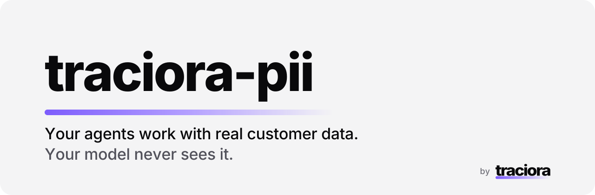
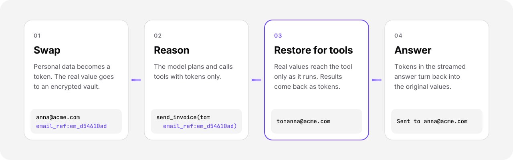
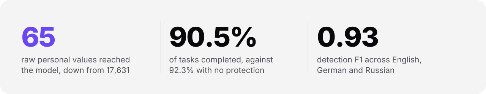
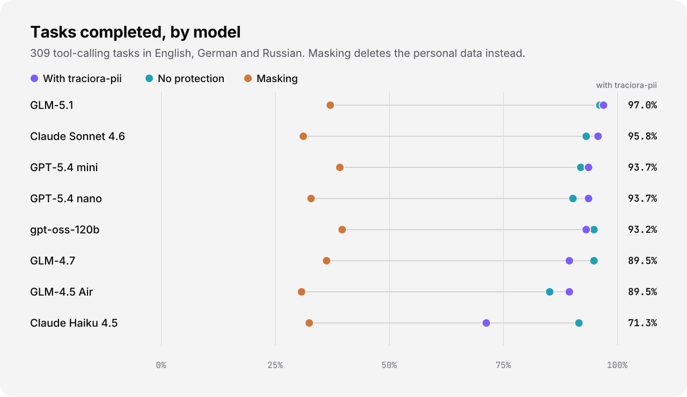
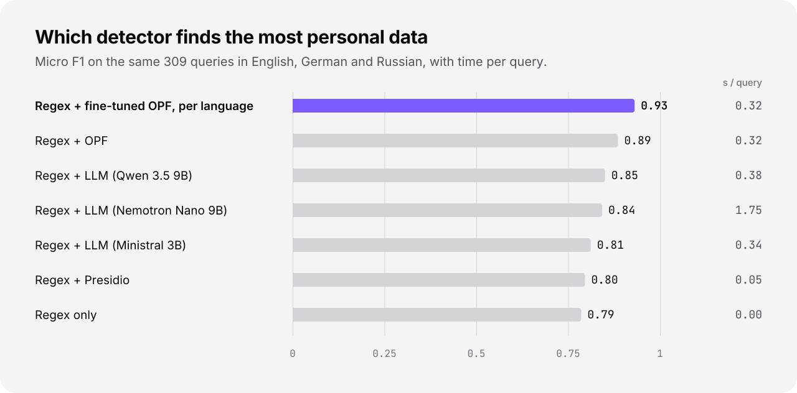

<picture>
  <source media="(prefers-color-scheme: dark)" srcset="docs/assets/hero-dark.svg">
  
</picture>

**traciora-pii is reversible PII protection for LLM tool-calling agents.**

An agent that books, invoices or replies to customers needs their names, emails and phone
numbers. The language model behind it does not. traciora-pii swaps personal data for
tokens before the model sees it and swaps the real values back in only where they are
needed: inside your tools and in the final answer to your user.

## How it works

<picture>
  <source media="(prefers-color-scheme: dark)" srcset="docs/assets/flow-dark.svg">
  
</picture>

Tokens are stable within a session, so the model can still tell two customers apart
and refer back to the same one. Originals live in an encrypted vault scoped to that session.

## Results

Eight LLMs ran the same 309 tool-calling tasks in English, German and Russian, with and without traciora-pii.

<picture>
  <source media="(prefers-color-scheme: dark)" srcset="docs/assets/stats-dark.svg">
  
</picture>

Deleting personal data instead (masking) leaves agents unable to finish two tasks in three. Swapping it for tokens keeps them working.

<picture>
  <source media="(prefers-color-scheme: dark)" srcset="docs/assets/dots-dark.svg">
  
</picture>

<picture>
  <source media="(prefers-color-scheme: dark)" srcset="docs/assets/bars-dark.svg">
  
</picture>

Numbers, methods and how to rerun them: [Reproduce the results](docs/reproduce.md).

## What you get

- **A vault, not a mask.** Values come back exactly, per session, encrypted at rest.
- **A tool broker.** Wrap any tool once; it receives real arguments and returns tokenized results.
- **A leak guard.** A check at the model boundary raises if a tracked raw value slipped through.
- **Streaming.** Tokens are restored in streamed answers, even when a token is split across chunks.
- **Your choice of detector.** Fast regex for English, German and Russian, plus an optional
  second pass: a fine-tuned token classifier, an encoder, any OpenAI-compatible LLM, or Presidio.
- **Your rules.** Leave chosen categories visible, such as plates or URLs, with one setting.

## Quick start

```bash
pip install "traciora-pii @ git+https://github.com/danilmezor/traciora-pii.git"
```

```python
from cryptography.fernet import Fernet
from traciora_pii import PIIVaultStore, PIIVirtualizer

vault = PIIVaultStore(":memory:", Fernet.generate_key())
vault.open_session("chat-1")
pii = PIIVirtualizer(vault)

safe = pii.anonymize_text("chat-1", "Email anna@acme.com about the invoice")
# "Email email_ref:em_… about the invoice"
pii.rehydrate_text("chat-1", safe)
# "Email anna@acme.com about the invoice"
```

Next: [Getting started](docs/getting-started.md) wraps a tool and guards the model boundary.

## Documentation

[How it works](docs/how-it-works.md) · [Getting started](docs/getting-started.md) ·
[Configuration](docs/configuration.md) · [Detectors](docs/detectors.md) ·
[Benchmarks](docs/benchmarks.md) · [Reproduce the results](docs/reproduce.md)

## License

[Apache-2.0](LICENSE). Made by [Traciora](https://traciora.com).
